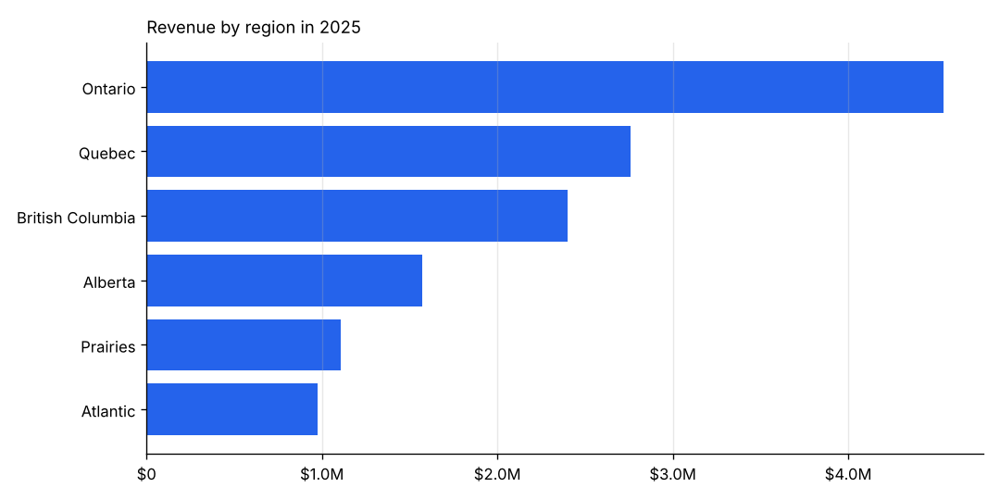
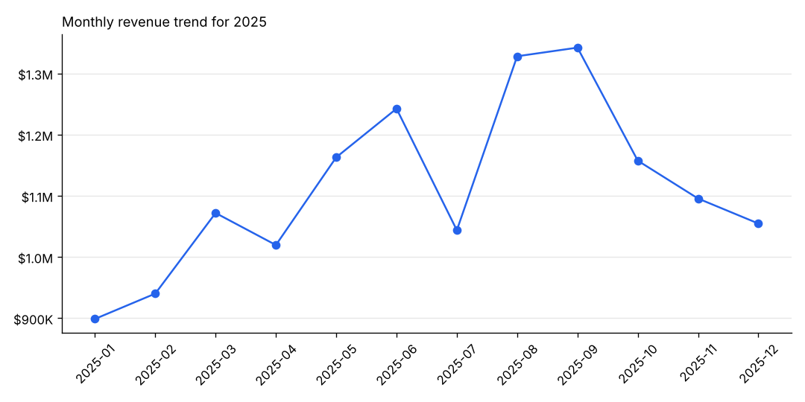
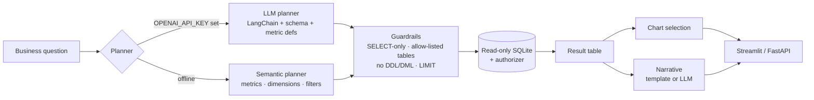

# 📊 AI Sales Analyst

**Ask sales questions in plain English, get back governed SQL, a chart, and a written insight, safely.**

[](https://github.com/silverlookz/ai-sales-analyst/actions)     

Business users shouldn't need SQL to answer "which region grew fastest this year?", and data teams can't let an LLM run arbitrary queries against a warehouse. This project sits in between:

- **Semantic layer first.** Metrics like *revenue*, *gross profit*, *margin %* and *average order value* are defined once in code, so "revenue" means the same thing in every answer, whether the SQL is written by the LLM or by the rule-based planner.
- **Defence-in-depth SQL guardrails.** Static validation, an enforced row limit, a read-only connection *and* an engine-level authorizer. Even if a prompt injection slipped past validation, the database refuses to write.
- **Answers, not just tables.** Every result comes with an auto-selected chart (line for time series, bar for rankings) and a narrative summary.
- **Works offline.** Without an API key it uses a deterministic semantic planner, which also makes it fully testable in CI.

> The warehouse is **synthetic**: 6,000 orders across 2024–2025 for a fictional Canadian tech retailer, generated with a fixed seed.

---




## How it works



### Data model

Star schema: `fact_order_lines` joined to `dim_product`, `dim_customer`, `dim_region` and `dim_date`.

| Metric | Definition |
|---|---|
| revenue | `SUM(revenue)` (net of discount) |
| gross_profit | `SUM(revenue - cost)` |
| margin_pct | `gross_profit / revenue × 100` |
| orders | `COUNT(DISTINCT order_id)` |
| avg_order_value | `revenue / orders` |
| units | `SUM(quantity)` |
| customers | `COUNT(DISTINCT customer_id)` |

Dimensions: month, quarter, year, region, zone, category, product, segment, channel, customer. Filters: years, quarters, and any region, category, segment or channel name.

## Example

```text
Q: What was the margin by category in Q4 2025?

SELECT p.category AS category,
       ROUND(100.0 * SUM(f.revenue - f.cost) / SUM(f.revenue), 1) AS margin_pct
FROM fact_order_lines f JOIN dim_product p ... JOIN dim_date d ...
WHERE d.year = 2025 AND d.quarter = 4
GROUP BY 1 ORDER BY margin_pct DESC LIMIT 1000

   category  margin_pct
   Services        78.8
Accessories        46.8
      Audio        40.1
   Displays        28.1
  Computers        25.0

Services leads on margin pct (year=2025, quarter=Q4) with 78.8%. Lowest shown is Computers at 25.0%.
```

Other questions that work: *"Monthly revenue trend for 2025"*, *"Top 5 products by gross profit"*, *"Average order value by segment"*, *"How many orders in Ontario in 2024?"*, *"Worst 3 products by units in Quebec"*.

## Quickstart

```bash
git clone https://github.com/silverlookz/ai-sales-analyst.git
cd ai-sales-analyst
python -m venv .venv && source .venv/bin/activate
pip install -r requirements.txt

python scripts/generate_data.py                                    # build data/sales.db
PYTHONPATH=src python -m sales_analyst.analyst "Revenue by region in 2025"
streamlit run app/streamlit_app.py                                 # UI
PYTHONPATH=src uvicorn api.main:app --reload                       # API at :8000/docs
pytest
```

Set `OPENAI_API_KEY` (see `.env.example`) to switch to the LLM planner and LLM-written narratives.

## Guardrail test coverage

The tests try to break it: `DROP`, stacked statements (`SELECT 1; DELETE ...`), `UPDATE`, `PRAGMA`, `sqlite_master` access and joins to non-allow-listed tables are all rejected. A separate test **bypasses validation entirely** and confirms the read-only authorizer still blocks the write.

## Project structure

```
├── scripts/generate_data.py      # seeded synthetic star-schema warehouse
├── src/sales_analyst/
│   ├── planner.py                # semantic layer + semantic & LLM planners
│   ├── guardrails.py             # SQL validation + read-only connection
│   └── analyst.py                # orchestration, chart choice, narratives
├── api/main.py                   # FastAPI
├── app/streamlit_app.py          # UI
└── tests/                        # guardrail, planner and API tests
```

## Taking it further

- Point the planner at Snowflake / Databricks / Postgres via SQLAlchemy; keep the authorizer idea by using a read-only role.
- Load metric definitions from a dbt semantic layer or a YAML catalogue instead of Python.
- Add row-level security by injecting the user's region/segment entitlements into every `WHERE` clause.
- Log every question → SQL → result for audit and for building a regression set of real questions.

## License

MIT
